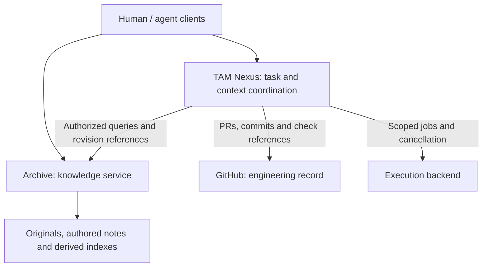

# Archive evolution and TAM Nexus boundaries

Status: proposed incremental architecture, not migration authorization. 2026-11-17. Grounding: [repository audit](REPOSITORY_AUDIT.md). Sequencing: [roadmap](IMPLEMENTATION_ROADMAP.md).

## Assessment

Archive can evolve incrementally. Keep the Flask/Jinja human interface, Markdown authored notes, original documents and existing ingestion modules. The registry, structural spans, source previews and table/figure sidecars already establish useful boundaries. The main weaknesses are mutable file integrity, inconsistent identity, unversioned APIs, incomplete trust boundaries and unbounded scanning—not evidence that the application needs replacing.

Fix demonstrated content and rendering defects before making Archive a shared agent service. A local-first deployment must remain usable without Nexus, a cloud model or a mandatory account. Shared-shop access is a separate security mode whose policy requires owner approval. Do not expose today's development server as that service.

## Ownership and interfaces

| Component | Canonical responsibility | Explicit exclusion |
|---|---|---|
| Archive | Source bytes, authored content, provenance/revisions, assertions, relationships, search/retrieval, resource access decisions | Agent job scheduler, duplicate Git history, task execution |
| GitHub | Source code, branches, issues/PRs, reviews, check results and merge state | Personal knowledge corpus |
| Nexus | Project/agent registry, scoped task authorization references, execution runs, context packet assembly/cache, telemetry references | Replacement document store, parallel PR database or CAD/game runtime dependency |
| Execution backend | Isolated worker lifetime, tooling, resource budget, outputs, cancellation | Authority to grant itself new permissions |

Service boundaries are logical initially. Extract a small Archive service layer from route/core calls as needed; do not split everything into network services. Tests should call the same service contract as UI/API adapters. Nexus is optional for Archive clients; a direct local client remains supported.

## Archive v1 data contracts (proposed)

| Record | Minimum semantics |
|---|---|
| Source/document | Existing stable doc ID; source SHA-256, byte length/media type, created time, source revision; preserve original path privately, not in unrestricted responses |
| Authored note | Stable note ID independent of display title/path; revision, author/provenance, exact retained body and unknown metadata fields |
| Derived generation | Source revision/hash, pipeline/schema version, options/dependency fingerprint, generation ID, status/error; independently rebuildable |
| Citation | Document ID + source revision + PDF viewer page (one-based) + optional printed label + coordinates/text span + generation reference; never rely only on current array index |
| Assertion | Statement, author, author-confidence declaration, cited evidence, applicability/context, separate verification records |
| Verification | Status such as unreviewed/supported/contradicted/inconclusive; verifier identity, method, evidence, time and exact claim/source revisions; superseding invalidates applicability until reviewed |
| Relationship | Typed, directed references (supports, contradicts, derived-from, supersedes, related-to), author and evidence; no automatic truth propagation |

Author confidence answers “how sure was the author?” Independent verification records an independently performed check and its method. A model rephrasing the same source is not independent corroboration; source-viewing UI is not a stored verification event. Confidence must be contextual: units, material, revision/date, operating conditions, jurisdiction or machine model where applicable. Do not average contradictory claims into a universal trust percentage. Retain disagreement and evidence. For example, a machining value may be source-accurate yet inapplicable to a different alloy or tool.

Legacy note IDs should be preserved where present; absent/duplicate IDs require an explicit mapping report and reviewed repair plan. Preserve old URLs through adapters where feasible. Source digest identifies bytes, not independent authorship: identical copies are one source lineage for verification purposes. Existing positional structural references need mapping by source span/generation; ambiguous mappings remain unresolved rather than silently redirecting citations.

## Durability and migration design

1. Introduce explicit archive-root configuration behind existing functions, maintaining the legacy root by default. Separate authored content, immutable originals and rebuildable outputs logically before moving anything.
2. Use atomic single-file replacement and serialized writes with revision checks. Document-level multi-file changes need a staged generation plus one manifest/pointer publication step; individual atomic renames do not make the group atomic.
3. Add schema versions and additive metadata readers/writers preserving unknown fields. Validate source digests, IDs and reference integrity before publication. Isolate the writer; readers see a complete prior or new generation.
4. A future migration runs an inventory and dry-run, backs up originals/authored content, writes new representations beside old, verifies byte counts/hashes/references, then explicitly cuts over. Keep the old read path and backup until a restore drill succeeds. Halt on duplicate IDs, conflicting revisions or missing sources. Do not repair silently.
5. Rollback restores a coherent generation/catalog with original content intact; restoration must be tested on a disposable copy. No destructive migration during WO-001 or its baseline CI follow-up.

SQLite may eventually hold the local transactional catalog, assertions/relationships and a rebuildable FTS index. Measure retrieval latency and corpus size first. Keep original files and authored notes exportable and authoritative; catalog loss must not destroy them. One local writer and explicit optimistic revision checks are simpler than distributed databases. Network filesystem/multi-host writes need a separate design; SQLite is not an implicit approval for that topology.

## Retrieval and source integrity

Add a versioned read-only service surface before agent write tools. Candidate operations are `search`, `get_note`, `get_document`, `get_citation_context` and `get_revision`; these names are proposals. Return IDs/revisions, source spans, extraction warnings, verification state and clear truncation/pagination metadata. Bound result sizes, deadlines and preview rendering. Tests should distinguish PDF viewer pages from printed labels, verify source hashes before/after ingestion, and search text beyond current structural previews.

Large-document structural-only storage already reduces generated files, but extraction currently accumulates all pages/chunks. Benchmark memory, wall time and retrieval completeness on synthetic large PDFs. Only then select streaming/chunk batching or FTS changes. Preserve existing table/figure recovery and never substitute inferred numeric values for uncertain extraction. A source view is authoritative evidence of what the document says, not a guarantee that the document is true.

## Authorization and local-first operation

Today’s Public/Private labels are not ACLs. Define owner-approved identities, collections and grants before shared access: personal material denied to shop agents by default; explicit read/write scopes per project/resource; no privilege granted by a client-supplied role string. Enforce access in Archive on every search, snippet, source download, figure, preview, citation and write—not only in Nexus or the UI. Prevent cross-principal cache leaks and redact local paths. Revocation must take effect on cached responses; fail closed when policy cannot be checked.

Use loopback-only/no-debug operation for the current local mode, safe HTML escaping and mutation protections as bounded hardening. Before shared/network mode: authenticated identities, transport protections, authorization tests, audit events and owner-approved retention/data-sharing policy. Agents should get read-only access first. Imported documents, retrieved text and tool descriptions are untrusted data; embedded instructions cannot expand permissions. Public-repository CI must use synthetic/public fixtures, never upload personal PDFs or logs containing them.

## Preliminary Nexus architecture

Start only with a demonstrated second consumer or repeated coordination problem. A small local process and versioned config may suffice; no message broker, vector database, custom identity provider or plugin marketplace by default.

| Capability | Minimal proposed contract / behavior |
|---|---|
| Project registry | Stable project ID, repository URI, default branch, local path hint, test entrypoints, policy reference; validate paths rather than execute arbitrary config |
| Agent registry | Executor/provider reference, capabilities, availability, version and allowed roles; registry entry is not authorization |
| Tool discovery | Allowlisted MCP servers and explicit tool schemas/version hashes; discovery does not imply permission; no automatic arbitrary server installation |
| Tool authorization | Host-issued grants scoped to identity/project/task/tool/resource/time; Archive and GitHub still enforce their own resource permissions |
| GitHub adapter | Read current refs/checks; create/update authorized branches/PRs with expected-head guard; no automatic merge |
| Archive adapter | Versioned authorized read API; retain knowledge IDs/revisions/citation links, not an alternate corpus |
| Orchestration | Run state, bounded attempts, cancellation, leases and restart checkpoints; external executor interface, not dependence on a permanent chat session |
| Telemetry | Task/run IDs, model/tool versions, start/end, exit status, artifact hashes/references, measured usage where available; private logs local by default |
| CSI packets | Versioned JSON plus human-readable constraints/evidence; schema negotiation and rejection rules, described in AGENT_ORCHESTRATION |
| Context cache | Scoped to principal, project, policy revision, source revisions and schema; reauthorize on read; invalidate on changed sources/ACLs/tool schema/repo SHA |
| Cross-project knowledge | Archive IDs/revisions with explicit relationship/permission; never leak personal context merely because two projects share an agent |

MCP is an interoperability adapter, not the durable job scheduler or resource authorization implementation. Choose a concrete supported protocol version when implementing and test negotiation. HTTP and stdio have distinct authorization models; the protocol does not remove the need for application policy. See [MCP authorization specification, version 2025-11-25](https://modelcontextprotocol.io/specification/2025-11-25/basic/authorization), consulted 2026-11-17 as a concrete versioned reference, not a claim that it is the latest. Add read-only MCP tools only after the underlying Archive API and access checks are reliable.

HERO-CAD must retain its explicit offline/no-telemetry/no-account design. Optional external Nexus development coordination must not become a CAD dependency or silently collect application activity. Requisition Denied likewise does not gain gameplay AI or network dependencies from this audit.

## Recommendation ledger

| ID | Recommendation / benefit | Complexity / maintenance | Dependencies | Risks | Human approval |
|---|---|---|---|---|---|
| A1 | Preserve note identity/metadata, reject escaping paths and collisions; protect authored content | Low–medium / low | Baseline + regression fixtures | Legacy behavior compatibility | Scoped WO and merge; collision behavior agreed in spec |
| A2 | Escape content, safe local launch/mutations; reduce local content trust risk | Low–medium / low | Rendering and route tests | Breaking highlights or launch expectations | WO/merge; policy/network changes explicit approval |
| A3 | Storage/service seam, revision checks and staged generations; recoverable writes | Medium / medium | A1, fixtures | Partial cutover, locking mistakes | WO/merge; actual migration separately approved |
| A4 | Source/revision/citation identity; durable references and provenance | Medium / medium | A3 and legacy inventory | Broken old links, false source equivalence | WO/merge; content migration explicit |
| A5 | Contextual assertions and independent verification records | Medium / medium | A4, owner-approved semantics | False authority or burdensome UX | Product semantics/UX and merge |
| A6 | Versioned read API, measured retrieval/large-document improvements | Medium / medium | A4, benchmarks | Stale/incomplete indexes | WO/merge; no external service implied |
| A7 | Real access controls before shared/agent access | Medium–high / medium | Identity/policy decisions, A6 | Leakage via snippets/cache/files | Security/privacy policy and deployment approval |
| N1 | Minimal registry/CSI/read adapter for demonstrated need | Medium / low–medium | A6/A7, second consumer | Premature infrastructure | Separate infrastructure WO and merge |
| N2 | Optional durable orchestration/telemetry | High / high | N1 plus execution backend and measured friction | Secrets, costs, privacy, runaways | Explicit policy/budget/host approval |

All recommendations are proposals. No schema migration, service deployment, account/security setting change or application refactor is performed by WO-001.
